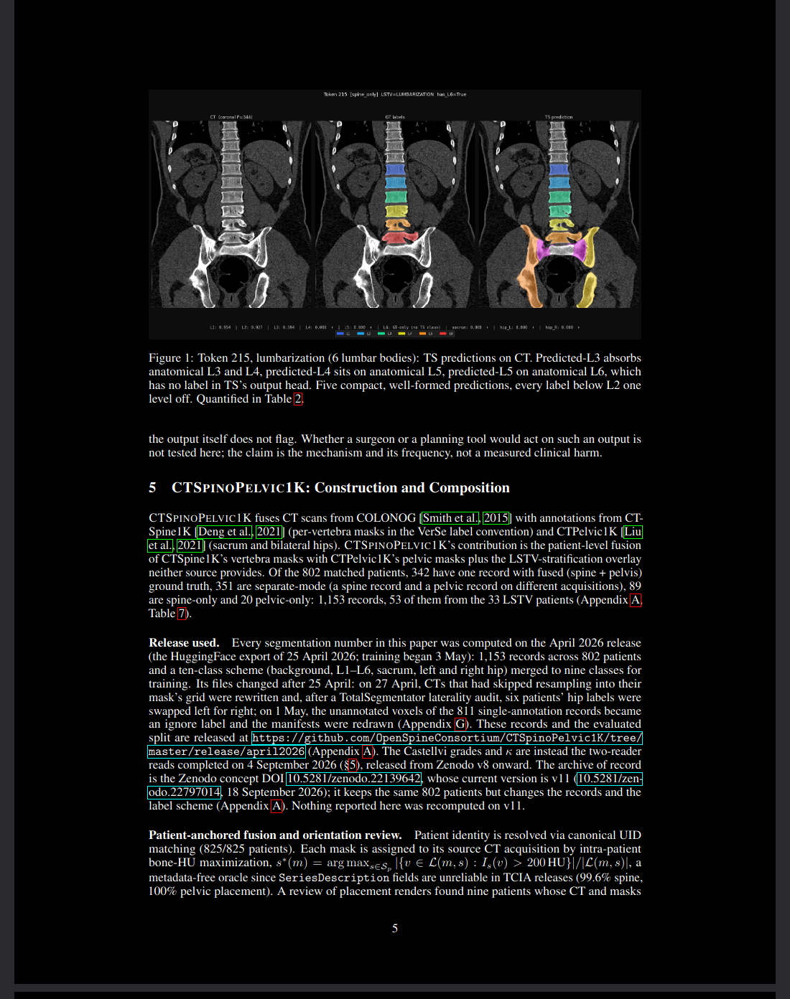

# Firefox PDF Reader

[](https://github.com/Gregory-Schwing-MD-PhD/firefox-pdf-reader/actions/workflows/test.yml)

## Install

### **[⬇ Download Firefox PDF Reader](https://gregory-schwing-md-phd.github.io/firefox-pdf-reader/#install)**

The download page detects your system and gives you the matching download. Each one sets up the reader and makes it your default PDF app:

| System | Download | How it installs |
| --- | --- | --- |
| Windows | [FirefoxPDFReader-Setup.cmd](https://github.com/Gregory-Schwing-MD-PhD/firefox-pdf-reader/releases/latest/download/FirefoxPDFReader-Setup.cmd) | Double-click it. Installs Firefox too, if it's missing. |
| macOS | [FirefoxPDFReader.dmg](https://github.com/Gregory-Schwing-MD-PhD/firefox-pdf-reader/releases/latest/download/FirefoxPDFReader.dmg) | Drag **Firefox PDF Reader** into **Applications**, then open it once. |
| Ubuntu, Debian, Mint, Pop!_OS | [FirefoxPDFReader.deb](https://github.com/Gregory-Schwing-MD-PhD/firefox-pdf-reader/releases/latest/download/FirefoxPDFReader.deb) | Double-click it to install. Brings Firefox with it. |
| ChromeOS | [FirefoxPDFReader.deb](https://github.com/Gregory-Schwing-MD-PhD/firefox-pdf-reader/releases/latest/download/FirefoxPDFReader.deb) | Turn on Linux, then double-click it in **Files**. |

The Mac app isn't signed by an Apple-registered developer yet, so the first time you open it, macOS asks you to allow it. Go to **System Settings → Privacy & Security** and click **Open Anyway**; you only do this once.

<details>
<summary>Or install from a terminal</summary>

**Windows (PowerShell):**

```powershell
powershell -c "irm https://gregory-schwing-md-phd.github.io/firefox-pdf-reader/install/windows.ps1 | iex"
```

**macOS, Linux (including Fedora, Arch and others), ChromeOS (Terminal):**

```sh
curl -fsSL https://gregory-schwing-md-phd.github.io/firefox-pdf-reader/install/install.sh | sh
```

On ChromeOS, first turn on Linux: **Settings → About ChromeOS → Developers → Linux development environment**.

To install from a copy of this repository, or to uninstall, see [INSTALL.md](INSTALL.md).
</details>

## Try it


This is the actual reader showing the example paper from its colour figure on page 5: what Firefox, with the reader's own settings and viewer, draws inside the reader's window, captured at 1440 × 900 and shown at exactly 640 × 400, the same shape with nothing cropped.



The whole of that page, as the reader draws it: black page, white text, and the figure (CT images, grey, with coloured vertebrae) exactly as the PDF has it.

GitHub doesn't allow interactive content in a README. To scroll the paper yourself, click the animation or open the **[interactive demo](https://gregory-schwing-md-phd.github.io/firefox-pdf-reader/demo.html)**, which draws pages with the reader's own copy of pdf.js. It remembers where you were, and F or a double-click makes it full screen.

## Features

- **Black pages, white text, pictures in their own colours.** Every page is black and its text white. Pictures (photographs, scans, X-ray and CT images, greyscale or colour) are drawn exactly as the PDF has them, never inverted, and charts and diagrams keep all their colours; only their black and grey lines turn white or grey, so axes and table lines stay visible on black. The space around the pages is dark grey. See [Colours](#colours) for exactly what changes.
- **Nothing but the PDF.** Each PDF opens in a window that fills the screen with its pages, under your system's own title bar: no tabs, address bar, toolbar, sidebar or notice bars.
- **One window per PDF.** Every PDF gets a window of its own, named after its file, so you switch between them like any other windows: **Alt+Tab** on Windows and Linux, **Cmd+`** on a Mac.
- **Full screen when you want it, and a way out.** **F11** makes a PDF full screen and **F11** again brings the window back (on a Mac: **Ctrl+Cmd+F**, and **Esc** to leave). For the first seconds of full screen, a short note at the bottom says how to leave it. A window can always be minimised, switched away from and closed like any app.
- **Continuous.** One long vertical scroll through every page, fit to the page width.
- **Remembers your spot.** Reopen a PDF and you're back where you left off, at the same zoom.
- **Smooth scrolling.** Firefox's smooth scrolling, set up to work with your mouse's own smooth scrolling. See [Smooth scrolling](INSTALL.md#smooth-scrolling) for Logitech and other mice.
- **Low latency.** Pages are drawn on the graphics card (WebRender, with GPU-accelerated PDF rendering), and there are no add-ons, start page or session restore to wait for.
- **Default PDF app.** Double-click any PDF to open it in the reader.
- **Separate from your browser.** The reader runs in its own Firefox profile, so your normal Firefox, its bookmarks and extensions are untouched.
- **Private.** The reader's profile sends no usage data to Mozilla and runs no studies.
- **Works everywhere.** Windows, macOS, Linux (Ubuntu, Debian, Fedora, Arch and others, with Firefox from your distribution, Snap or Flatpak) and ChromeOS.
- **Tested.** Every change is installed and used on [GitHub Actions](https://github.com/Gregory-Schwing-MD-PhD/firefox-pdf-reader/actions/workflows/test.yml). On Windows, macOS and Ubuntu: two PDFs opened into two windows, switched with Alt+Tab (Cmd+`), made full screen and back, a link clicked, closed; a colour figure compared, pixel by pixel, with another PDF program's (poppler's) drawing of the same page; and a test page (text, a greyscale picture and a coloured chart, under a file name with spaces and other awkward characters) checked for a black page, white text and the picture and chart in their own colours. The ChromeOS-style Linux (Debian 12 with Firefox ESR) is installed, opens two PDFs into two windows of one reader, makes one full screen with F11 and back, and checks the same test page. Screenshots of every step are saved with each run.
- **Easy to remove.** One command uninstalls it; see [INSTALL.md](INSTALL.md).

**Keys:**

| | Windows, Linux | Mac |
| --- | --- | --- |
| Full screen | **F11**, and **F11** again to leave | **Ctrl+Cmd+F**, and **Esc** to leave |
| Switch between PDFs | **Alt+Tab** | **Cmd+`** |
| Close a PDF | **Ctrl+W** | **Cmd+W** |
| Close the reader | **Alt+F4** closes a window; the reader ends with its last one | **Cmd+Q** |
| Find text | **Ctrl+F**, Enter for the next match, Esc to close | **Cmd+F**, Enter for the next match, Esc to close |
| Zoom | **Ctrl +/−** | **Cmd +/−** |

Good to know:
- Firefox has no setting that starts an ordinary window full screen. Its kiosk mode does, but leaves no way out, which is what the reader used before. So the reader opens each PDF in a window that fills the screen, and F11 takes it the rest of the way.
- On Windows and Linux, Esc doesn't leave Firefox's full screen (Firefox keeps Esc there for its own bar) and Firefox has no setting to change that; F11 does. Moving the mouse to the top edge in full screen also slides down Firefox's bar, with buttons to leave full screen or close.
- On GNOME (Ubuntu's desktop), Alt+Tab groups windows by app: hold Alt and press **`** (the key above Tab) to step through the reader's windows. On Windows, Alt+Tab lists every window.
- On a Mac, a full-screen window is a space of its own: Cmd+` switches between the reader's windows that aren't full screen, and Ctrl+← / Ctrl+→ (or a swipe) between full-screen spaces. Cmd+Tab switches between apps.
- A window's title is the PDF's file name; on Windows and Linux the system adds Firefox's name after it, as in "paper.pdf — Mozilla Firefox". If the PDF has a title of its own, that comes first, then the file name.
- A web link in a PDF opens in a new window; close it (Ctrl+W, Cmd+W) to get back to the PDF. A PDF opened from a web link shows in Firefox's own viewer, in the PDF's own colours.
- Find (Ctrl+F, Cmd+F) opens a small find bar at the top right of the window.
- Printing prints the PDF's own colours: white paper, black text.

## Colours

Only plain greys change, and only in text, lines and filled shapes: white becomes black, black and dark grey become white, light grey becomes dark grey. Everything else is drawn exactly as the PDF has it:

- **Pictures** (photographs, scans, X-ray and CT images, in grey or in colour) are never changed or inverted. A scanned page is one picture, so it shows as it was scanned: dark text on light paper.
- **Colours** in charts, diagrams and text keep their colour: a red bar stays red, a blue link stays blue. Text printed in a very dark colour, such as navy, stays that colour and can be hard to read on black.
- **Smooth colour gradients** are drawn as the PDF has them, like pictures.
- **Labels and arrows drawn on top of a picture** (rather than being part of it) change like any other text and lines: a white arrow on an X-ray turns black.

How: Firefox's own PDF viewer can only recolour the whole page, pictures included (its "page colours" setting draws the finished page through one filter that turns every colour into shades of two). So the reader shows PDFs in its own copy of that viewer, pdf.js 6.5.438 from Mozilla, with a small change that swaps the greys of text, lines and fills and leaves pictures alone ([`viewer/NOTICE`](viewer/NOTICE), [`tools/make_viewer.py`](tools/make_viewer.py)).

**What this changes in the reader's Firefox profile:** that viewer is a page on your computer that has to read the PDF, another file on your computer, and Firefox lets a file on your computer read only itself unless `security.fileuri.strict_origin_policy` is off. The reader turns it off **in its own profile only**: there, a page opened from your disk can read other files on your disk. Your normal Firefox is not changed, and web pages can't read your files either way. So don't open HTML files you don't trust in the reader's windows.

## Updating

To update an installed reader, install it again the same way; nothing needs removing first, and the installers ask no questions. The new version opens PDFs on black pages with white text straight away:

- **Windows:** run **FirefoxPDFReader-Setup.cmd** again (or the PowerShell line above). Windows may warn again about a downloaded `.cmd` file (**More info → Run anyway**). Its window closes by itself when it's done. If the reader isn't your default PDF app, the Settings page opens so you can choose it; if it already is, it stays so and the Settings page doesn't open.
- **Mac:** download the new **FirefoxPDFReader.dmg** and drag the app into **Applications** again, replacing the old one (or run the Terminal line again).
- **Ubuntu, Debian, Mint, Pop!_OS, ChromeOS:** open the new **FirefoxPDFReader.deb** (or `sudo apt install ./FirefoxPDFReader.deb`).
- **Fedora, Arch and others:** run the Terminal line again.

Close the reader's windows first: the next PDF you open uses the new version. The update also undoes the earlier versions' settings that recoloured every page. The reader now keeps your place in each PDF in its own viewer, so after this update each PDF opens once at its first page, and from then on where you left off.

## License

The code in this repository (installers, launcher, Firefox settings and the website) is released under the [MIT License](LICENSE).

The example paper, [`docs/example.pdf`](docs/example.pdf) (*Not All Spines Are Created Equal: How CT Segmenters Fail on Lumbosacral Transitional Vertebrae*), is © its authors. It's included only as a demo document and is not covered by the MIT License.

The reader's PDF viewer, in [`viewer/`](viewer/), is [pdf.js](https://github.com/mozilla/pdf.js) 6.5.438 by Mozilla, under the Apache License 2.0 ([`viewer/LICENSE`](viewer/LICENSE)), with the changes listed in [`viewer/NOTICE`](viewer/NOTICE).

The reader uses Firefox, installed separately from Mozilla under the [Mozilla Public License 2.0](https://www.mozilla.org/MPL/2.0/). The web demo loads the reader's copy of pdf.js from this repository through jsDelivr. Firefox is a trademark of the Mozilla Foundation. This project is not affiliated with or endorsed by Mozilla.

## Contact

Questions, bugs or ideas: **[open an issue](https://github.com/Gregory-Schwing-MD-PhD/firefox-pdf-reader/issues/new/choose)**. Replies come through GitHub, so you don't need to share an email address.
