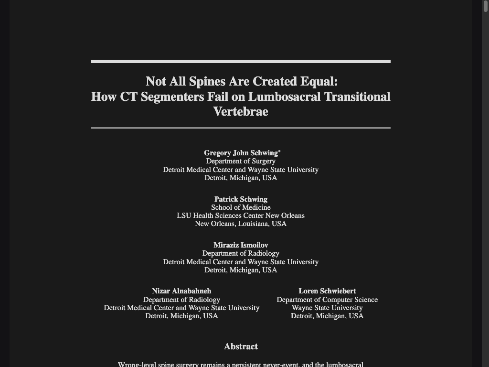

# Firefox PDF Reader

[](https://github.com/Gregory-Schwing-MD-PhD/firefox-pdf-reader/actions/workflows/test.yml)

## Install

### **[⬇ Download Firefox PDF Reader](https://gregory-schwing-md-phd.github.io/firefox-pdf-reader/#install)**

The download page detects your system and gives you the matching download. Each one sets up the reader and makes it your default PDF app:

| System | Download | How it installs |
| --- | --- | --- |
| Windows | [FirefoxPDFReader-Setup.cmd](https://github.com/Gregory-Schwing-MD-PhD/firefox-pdf-reader/releases/latest/download/FirefoxPDFReader-Setup.cmd) | Double-click it. Installs Firefox too, if it's missing. |
| macOS | [FirefoxPDFReader.dmg](https://github.com/Gregory-Schwing-MD-PhD/firefox-pdf-reader/releases/latest/download/FirefoxPDFReader.dmg) | Drag **Firefox PDF Reader** into **Applications**, then open it once. |
| Ubuntu, Debian, Mint, Pop!_OS | [FirefoxPDFReader.deb](https://github.com/Gregory-Schwing-MD-PhD/firefox-pdf-reader/releases/latest/download/FirefoxPDFReader.deb) | Double-click it to install. Brings Firefox with it. |
| ChromeOS | [FirefoxPDFReader.deb](https://github.com/Gregory-Schwing-MD-PhD/firefox-pdf-reader/releases/latest/download/FirefoxPDFReader.deb) | Turn on Linux, then double-click it in **Files**. |

The Mac app isn't signed by an Apple-registered developer yet, so the first time you open it, macOS asks you to allow it. Go to **System Settings → Privacy & Security** and click **Open Anyway**; you only do this once.

<details>
<summary>Or install from a terminal</summary>

**Windows (PowerShell):**

```powershell
powershell -c "irm https://gregory-schwing-md-phd.github.io/firefox-pdf-reader/install/windows.ps1 | iex"
```

**macOS, Linux (including Fedora, Arch and others), ChromeOS (Terminal):**

```sh
curl -fsSL https://gregory-schwing-md-phd.github.io/firefox-pdf-reader/install/install.sh | sh
```

On ChromeOS, first turn on Linux: **Settings → About ChromeOS → Developers → Linux development environment**.

To install from a copy of this repository, or to uninstall, see [INSTALL.md](INSTALL.md).
</details>

## Try it

[](https://gregory-schwing-md-phd.github.io/firefox-pdf-reader/demo.html)

**[▶ Open the interactive demo](https://gregory-schwing-md-phd.github.io/firefox-pdf-reader/demo.html)**: a browser version of the reader with an example paper open.
- Scroll through it.
- Press **F** or double-click for full screen.
- Come back later: it remembers where you were.

GitHub can't run interactive content inside a README, so the picture above links to the demo.

## Features

- **Dark.** A dark viewer, with pages recoloured to light grey text on near-black.
- **Full screen.** Every PDF opens straight into full screen, with no tabs, address bar or menus.
- **Nothing but the PDF.** No toolbar, sidebar or notice bars; just pages edge to edge.
- **Continuous.** One long vertical scroll through every page, fit to the page width.
- **Remembers your spot.** Reopen a PDF and you're back where you left off, at the same zoom.
- **Smooth scrolling.** Firefox's smooth scrolling, set up to work with your mouse's own smooth scrolling. See [Smooth scrolling](INSTALL.md#smooth-scrolling) for Logitech and other mice.
- **Low latency.** Pages are drawn on the graphics card (WebRender, with GPU-accelerated PDF rendering), and there are no add-ons, start page or session restore to wait for.
- **Default PDF app.** Double-click any PDF to open it in the reader.
- **Separate from your browser.** The reader runs in its own Firefox profile, so your normal Firefox, its bookmarks and extensions are untouched.
- **Private.** The reader's profile sends no usage data to Mozilla and runs no studies.
- **Works everywhere.** Windows, macOS, Linux (Ubuntu, Debian, Fedora, Arch and others, with Firefox from your distribution, Snap or Flatpak) and ChromeOS.
- **Tested.** Every change is installed and opened on Windows, macOS, Ubuntu and a ChromeOS-style Linux on [GitHub Actions](https://github.com/Gregory-Schwing-MD-PhD/firefox-pdf-reader/actions/workflows/test.yml).
- **Easy to remove.** One command uninstalls it; see [INSTALL.md](INSTALL.md).

**Keys:**
- **Alt+F4** closes the reader (**Cmd+Q** on a Mac).
- **Ctrl+Tab** switches between open PDFs.
- **Ctrl+W** closes one (**Cmd+W** on a Mac).
- **Ctrl+F** finds text.
- **Ctrl +/−** zooms.

## License

The code in this repository (installers, launcher, Firefox settings and the website) is released under the [MIT License](LICENSE).

The example paper, [`docs/example.pdf`](docs/example.pdf) (*Not All Spines Are Created Equal: How CT Segmenters Fail on Lumbosacral Transitional Vertebrae*), is © its authors. It's included only as a demo document and is not covered by the MIT License.

The reader uses Firefox, and its PDF viewer pdf.js, installed separately from Mozilla under the [Mozilla Public License 2.0](https://www.mozilla.org/MPL/2.0/). The web demo loads [pdf.js](https://github.com/mozilla/pdf.js) (Apache License 2.0) from cdnjs. Firefox is a trademark of the Mozilla Foundation. This project is not affiliated with or endorsed by Mozilla.

## Contact

Questions, bugs or ideas: **[open an issue](https://github.com/Gregory-Schwing-MD-PhD/firefox-pdf-reader/issues/new/choose)**. Replies come through GitHub, so you don't need to share an email address.
